# System Design — เสขาประจำวัน (Daily Life Portal)

| | |
|---|---|
| เวอร์ชัน | 0.5.0 (ตรงกับ `package.json`) |
| อัปเดตล่าสุด | 2026-11-20 |
| ผู้อ่าน | นักพัฒนา |
| คู่กับ | [PRD.md](PRD.md) · [docs/testing/](../testing/) · spec รายฟีเจอร์ใน [docs/features/](../features/) |

ไดอะแกรมใช้ [Mermaid](https://mermaid.js.org/) (GitHub แสดงผลให้เอง)

## สารบัญ
1. [ภาพรวมสถาปัตยกรรม](#1-ภาพรวมสถาปัตยกรรม)
2. [เทคโนโลยี](#2-เทคโนโลยี)
3. [โครงสร้างโค้ดและชั้นข้อมูล](#3-โครงสร้างโค้ดและชั้นข้อมูล)
4. [Feature Registry, Routing และ Provider](#4-feature-registry-routing-และ-provider)
5. [Authentication](#5-authentication)
6. [Theme](#6-theme)
7. [ฐานข้อมูล](#7-ฐานข้อมูล)
8. [Workflow (sequence diagram)](#8-workflow-sequence-diagram)
9. [Logic ที่เป็น pure function](#9-logic-ที่เป็น-pure-function)
10. [Error handling, Validation, Security](#10-error-handling-validation-security)
11. [Build, Deploy, Migration](#11-build-deploy-migration)
12. [กลยุทธ์การทดสอบ](#12-กลยุทธ์การทดสอบ)
13. [ข้อจำกัดและหนี้ทางเทคนิค](#13-ข้อจำกัดและหนี้ทางเทคนิค)

## 1. ภาพรวมสถาปัตยกรรม
แอปเป็น Single Page Application ฝั่ง client ล้วน ไม่มี backend ของตัวเอง เรียก Supabase (Auth + PostgreSQL) โดยตรงจากเบราว์เซอร์ด้วย publishable (anon) key ความปลอดภัยของข้อมูลอาศัย Row Level Security (RLS) ที่ฐานข้อมูล

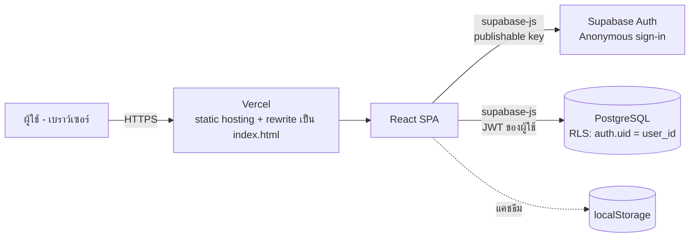

หลักการ
- ทุกตารางมี `user_id` ที่ default เป็น `auth.uid()` ผู้ใช้เข้าถึงได้เฉพาะแถวของตัวเอง
- ไม่ใช้ `service_role` key ในโปรเจกต์นี้เด็ดขาด
- การคำนวณที่ไม่ต้องเก็บ (เช่น เทียบราคา แปลงไซส์) ทำฝั่ง client ล้วน

## 2. เทคโนโลยี
| ส่วน | เทคโนโลยี | เวอร์ชัน (`package.json`) |
|---|---|---|
| UI | React, TypeScript (strict) | react ^19.3.1, typescript ~7.0.2 |
| Build | Vite | ^8.3.6 |
| Style | Tailwind CSS v4 (`@tailwindcss/vite`) | ^4.3.5 |
| Routing | React Router | react-router-dom ^7.18.5 |
| Icons | Lucide React | ^1.70.0 |
| Backend | Supabase (PostgreSQL + Auth) ผ่าน `@supabase/supabase-js` | ^2.119.0 |
| Lint | oxlint | ^1.90.0 |
| Test | `node:test` (Node ≥ 22.18 รัน TypeScript ตรง ๆ) | — |
| Hosting | Vercel | `vercel.json` rewrite ทุก path → `/index.html` |

ข้อห้ามของโปรเจกต์: ไม่ใช้ Next.js, Redux/state library อื่น, UI framework (MUI ฯลฯ) — state ใช้ React Hooks + Context เท่านั้น

## 3. โครงสร้างโค้ดและชั้นข้อมูล
```
src/
├── app/                     App, router, featureRegistry, ProtectedRoute
│   └── providers/           AuthProvider, ThemeProvider (+ Context)
├── shared/
│   ├── components/ui/       Button, IconButton, Input/Select/Textarea, Modal, ConfirmDialog,
│   │                        EmptyState, ErrorState, Spinner, Toast, Pagination, CollapsibleSection ...
│   ├── components/layout/   MainLayout, Sidebar, Header, PageHeader, ThemeToggle
│   ├── hooks/               useAuth, useToast, useTheme
│   ├── lib/                 supabase.ts, serviceError.ts, themeStorage.ts
│   ├── services/            preferenceService
│   ├── types/               FeatureConfig, ServiceResult
│   └── utils/               formatCurrency, formatDate, theme
├── features/<ชื่อ>/         components, hooks, services, types, utils, pages, constants, index.tsx, lazyPages.ts
│   ├── todo  randomizer  finance  calorie  unit-price  expiry-tracker  size-converter  mood
├── pages/                   PortalHomePage, NotFoundPage, LoginPage (โครงเปล่า)
└── styles/index.css         Tailwind + ตัวแปรสีธีม
supabase/migrations/         SQL แยกไฟล์ตามลำดับ (core ก่อน แล้วแยกตามฟีเจอร์)
tests/                       เทสต์ของ pure function (node:test)
docs/                        spec, testing, คู่มือ
```

### ชั้นข้อมูล (UI → Hook → Service → Supabase)
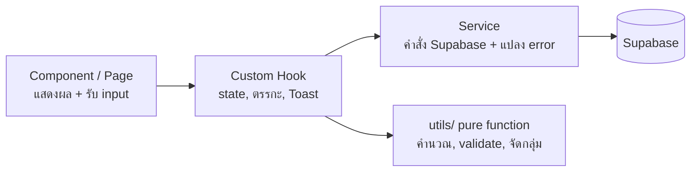
- **Component ห้ามเรียก Supabase ตรง** และฟีเจอร์ห้าม import โค้ดภายในของฟีเจอร์อื่น (ของร่วมอยู่ใน `src/shared/`)
- **Service** คืน `ServiceResult<T>` = `{ data, error: null } | { data: null, error: string }` ไม่ throw; error แปลเป็นข้อความไทยผ่าน `serviceFail()` (รหัส `23505` ชื่อซ้ำ, `23503` ถูกอ้างอิงอยู่ แปลเป็นข้อความเฉพาะ ส่วนอื่นบันทึกลง console และคืนข้อความทั่วไป)
- **Hook** ถือ state โหลด/error/ข้อมูล, เรียก service, แจ้ง Toast, `refresh` โดยไม่ reload หน้า
- **ลำดับสร้างในแต่ละฟีเจอร์:** Migration → Types → Service → Hook → UI

## 4. Feature Registry, Routing และ Provider
`FeatureConfig` (`src/shared/types/feature.ts`): `id`, `name`, `description`, `icon`, `path`, `routes` แต่ละฟีเจอร์ export ค่านี้จาก `index.tsx` แล้วลงทะเบียนใน `src/app/featureRegistry.ts` — Sidebar, หน้า Portal และ Router สร้างจากรายการนี้อัตโนมัติ

| id | ชื่อเมนู | path | หน้าย่อย |
|---|---|---|---|
| `todo` | วันนี้ทำอะไรดี | `/todo` | — |
| `randomizer` | สับสนช่วยหน่อย | `/randomizer` | — |
| `finance` | เงินฉันไปไหน | `/finance` | `transactions`, `summary`, `categories` |
| `calorie` | ผอมไปด้วยกัน | `/calorie` | `food`, `summary`, `foods`, `bmr` |
| `unit-price` | อันไหนถูกกว่า บอกมา | `/unit-price` | — |
| `expiry-tracker` | อย่าลืมฉัน | `/expiry-tracker` | — |
| `size-converter` | ไซส์ไหนคือฉัน | `/size-converter` | `converter`, `profiles`, `notes` |
| `mood` | ตัวฉันวันนี้ | `/mood` | `today`, `calendar`, `summary`, `settings` |

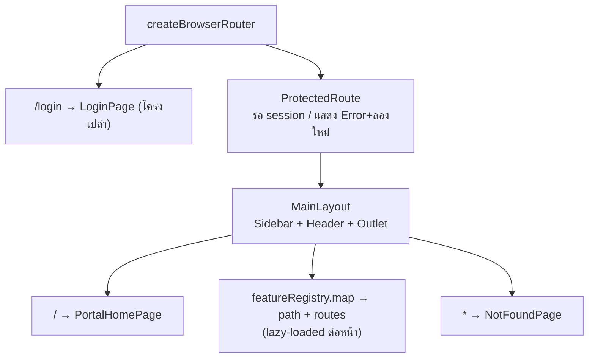

ลำดับ Provider (`src/app/App.tsx`): `ToastProvider` → `AuthProvider` → `ThemeProvider` → `RouterProvider`
(ThemeProvider อยู่ใต้ AuthProvider เพราะต้องรอ session ก่อนโหลด/บันทึกธีม)

การเพิ่มฟีเจอร์ใหม่ = สร้างโฟลเดอร์ใน `src/features/` + ลงทะเบียนในไฟล์ Registry + (ถ้ามีข้อมูล) migration ใหม่ ดูคู่มือ [adding-a-feature.md](../adding-a-feature.md)

## 5. Authentication
- `AuthProvider` (`src/app/providers/`) เป็นจุดเดียวที่จัดการ session/user; ผู้ใช้เข้าถึงผ่าน `useAuth()`
- เปิดแอป: `getSession()` → ถ้ามี session ใช้เลย ถ้าไม่มี `signInAnonymously()` อัตโนมัติ; ล้มเหลวแสดง Error พร้อมปุ่มลองใหม่ (เช่น ยังไม่เปิด Anonymous Sign-ins หรือยังไม่ตั้ง `.env`)
- `ProtectedRoute` ครอบทุก route ยกเว้น `/login`; อนาคตเมื่อเลิก anonymous จะ redirect ไป Login
- การเปลี่ยนเป็น Email/OAuth ในอนาคต: ผูก anonymous user เดิมกับบัญชีจริงด้วย `updateUser`/`linkIdentity` เพื่อให้ `user_id` เดิม (และข้อมูล) ไม่เปลี่ยน — ดู [future-login.md](../future-login.md)
- Env: `VITE_SUPABASE_URL`, `VITE_SUPABASE_PUBLISHABLE_KEY` (มี `.env.example` ไม่มีค่าจริง); `.env` อยู่ใน `.gitignore`

## 6. Theme
- ค่า: `light` | `dark` (`resolveTheme()` คืน `light` ถ้าไม่รู้จัก) ใช้ `<html data-theme>`; สีจริงกำหนดใน `src/styles/index.css` โดยสลับตัวแปรสีกลางของ Tailwind (gray-*, white) ทำให้คอมโพเนนต์เดิมเป็นโหมดมืดได้โดยไม่ใส่ `dark:` ทีละไฟล์ (สีเขียว/แดง/ป้ายปรับเฉพาะจุด)
- แหล่งความจริง = ตาราง `user_preferences` (upsert `onConflict: user_id`); แคชใน `localStorage` ('theme') + สคริปต์ inline ใน `index.html` ตั้งธีมก่อน React โหลดเพื่อกันหน้าจอวาบขาว; `localStorage` ใช้ไม่ได้ก็ทำงานต่อได้
- เปลี่ยนธีมแล้วใช้ทันที บันทึกเบื้องหลังผ่านคิว (กดเร็ว ๆ ส่งเฉพาะค่าล่าสุด); ค่าที่โหลดทีหลังไม่ทับถ้าผู้ใช้กดเลือกเองแล้ว; บันทึกพลาด = Toast และธีมยังใช้ต่อ

## 7. ฐานข้อมูล
### 7.1 ข้อกำหนดกลาง (ทุกตาราง)
| ข้อกำหนด | รายละเอียด |
|---|---|
| คอลัมน์มาตรฐาน | `id uuid pk default gen_random_uuid()`, `user_id uuid not null default auth.uid() references auth.users(id) on delete cascade`, `created_at`, `updated_at timestamptz not null default now()` |
| Trigger | `set_updated_at()` (core migration ตั้ง `search_path = ''`) ผูกกับทุกตารางแบบ BEFORE UPDATE |
| RLS | เปิดทุกตาราง; policy `to authenticated` `auth.uid() = user_id` ครบ SELECT/INSERT/UPDATE/DELETE |
| ค่าตัวเลือกจำกัด | CHECK constraint (status, type, category ฯลฯ) |
| ชื่อห้ามซ้ำ | unique index บน `(user_id, lower(btrim(name)))` |
| Index | `user_id` เสมอ + ฟิลด์ที่ filter/sort |
| RPC | `security invoker`, `set search_path = ''`, `revoke … from public, anon`, `grant … to authenticated` |

### 7.2 ER diagram
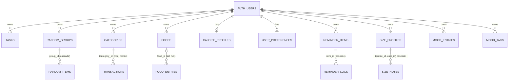
ตารางทั้งหมดมี `user_id → auth.users(id)` (ลบผู้ใช้ = ลบข้อมูลทั้งหมดตาม) เส้นจาก AUTH_USERS ที่วาดไว้แสดงเฉพาะตารางหลักเพื่อให้อ่านง่าย (`random_items`, `transactions`, `food_entries`, `reminder_logs`, `size_notes`, `mood_entries`, `mood_tags` ก็มี `user_id` เช่นกัน)

### 7.3 Schema รายตาราง
**`tasks`** (To-do) — migration `…000100_todo`, `…000200_todo_status_unique_limits`
| คอลัมน์ | ชนิด | กฎ |
|---|---|---|
| title | text | NOT NULL, ไม่ว่าง, ≤ 100, UNIQUE `(user_id, lower(btrim(title)))` |
| description | text | NULL ได้, ≤ 1000 |
| status | text | NOT NULL default `pending`, CHECK ∈ (`pending`,`in_progress`,`done`) |
| completed_at | timestamptz | NULL ได้ ตั้งโดย trigger `tasks_set_completed_at` |
Index: `user_id`, `(user_id, created_at)`, `(user_id, status, created_at)`

**`random_groups`**, **`random_items`** (Randomizer) — `…000300_randomizer`
| ตาราง.คอลัมน์ | ชนิด | กฎ |
|---|---|---|
| random_groups.name | text | NOT NULL, ไม่ว่าง, ≤ 50, UNIQUE `(user_id, lower(btrim(name)))` |
| random_items.group_id | uuid | NOT NULL FK → random_groups(id) ON DELETE CASCADE |
| random_items.label | text | NOT NULL, ไม่ว่าง, ≤ 100 |

**`categories`**, **`transactions`** (Finance) — `…000400_finance`, `20261110000100_finance_thai_categories`
| ตาราง.คอลัมน์ | ชนิด | กฎ |
|---|---|---|
| categories.name | text | NOT NULL, ไม่ว่าง, ≤ 50 |
| categories.type | text | NOT NULL, CHECK ∈ (`income`,`expense`) |
| categories.description | text | NULL ได้, ≤ 200 |
| categories | — | UNIQUE `(id, type)` (รองรับ composite FK); UNIQUE index `(user_id, type, lower(btrim(name)))` |
| transactions.transaction_date | date | NOT NULL default `current_date`, CHECK `<= current_date + 1` (เผื่อ UTC; ฟอร์มตรวจเวลาท้องถิ่นเข้มงวด) |
| transactions.type | text | NOT NULL, CHECK ∈ (`income`,`expense`) |
| transactions.category_id | uuid | NOT NULL; FK `(category_id, type)` → categories(id, type) ON DELETE RESTRICT (type ของรายการต้องตรงกับหมวด และห้ามลบหมวดที่ถูกใช้) |
| transactions.amount | numeric(12,2) | NOT NULL, `> 0` |
| transactions.description | text | NULL ได้, ≤ 200 |
Index: `transactions(user_id)`, `(user_id, transaction_date)`, `(category_id)`; `categories(user_id)`

**`calorie_profiles`**, **`foods`**, **`food_entries`** (Calorie) — `20261110000200_calorie`
| ตาราง.คอลัมน์ | ชนิด | กฎ |
|---|---|---|
| calorie_profiles | — | UNIQUE `(user_id)` = 1 แถวต่อผู้ใช้ |
| .sex / .age / .weight_kg / .height_cm | text / int / numeric(5,1) / numeric(4,1) | CHECK ∈ (`male`,`female`) / 10–100 / 20–300 / 100–250 |
| .activity_level | text | CHECK ∈ (`sedentary`,`light`,`moderate`,`active`,`very_active`) |
| .bmr / .tdee | int | NOT NULL, `> 0` |
| foods.name / serving_unit | text | NOT NULL, ไม่ว่าง, ≤ 100 / ≤ 20; UNIQUE `(user_id, lower(btrim(name)))` |
| foods.kcal_per_unit | numeric(7,1) | NOT NULL, 0–10,000 |
| foods.source | text | NOT NULL default `user`, CHECK ∈ (`seed`,`user`) |
| food_entries.eaten_on | date | NOT NULL default `current_date`, CHECK `<= current_date + 1` |
| food_entries.meal | text | CHECK ∈ (`breakfast`,`lunch`,`dinner`,`snack`) |
| food_entries.food_id | uuid | NULL ได้ FK → foods(id) ON DELETE SET NULL |
| food_entries.food_name / serving_unit / kcal_per_unit | text/text/numeric(7,1) | **สำเนา ณ ตอนกิน** (ข้อจำกัดเหมือน foods) แก้/ลบอาหารภายหลังประวัติไม่เปลี่ยน |
| food_entries.quantity | numeric(6,2) | NOT NULL, `> 0` และ ≤ 100 |
Index: `foods(user_id)`; `food_entries(user_id)`, `(user_id, eaten_on)`, `(food_id)`

**`user_preferences`** (Theme) — `20261113000100_user_preferences`: `theme text not null default 'light' check in ('light','dark')`, UNIQUE `(user_id)`

**`reminder_items`**, **`reminder_logs`** (อย่าลืมฉัน) — `20261116000100_expiry_tracker`, `…000200_expiry_tracker_medical`
| ตาราง.คอลัมน์ | ชนิด | กฎ |
|---|---|---|
| reminder_items.category | text | NOT NULL, CHECK ∈ (`document`,`vehicle`,`home`,`medical`,`subscription`,`other`) (`medical` เพิ่มโดย migration ที่ 2) |
| .name | text | NOT NULL, ไม่ว่าง, ≤ 100 |
| .due_date | date | NOT NULL |
| .repeat_every / .repeat_unit | int / text | CHECK 1–1000 / ∈ (`day`,`month`,`year`); ต้องมีทั้งคู่หรือไม่มีเลย |
| .remind_before_days | int[] | NOT NULL default `{}`; ≤ 10 ค่า, ไม่มี NULL, แต่ละค่า 0–730 (UI เลือก 1 ระดับ; ค่าเดิมหลายระดับยังรองรับ) |
| .cost | numeric(12,2) | NULL ได้, 0–100,000,000 |
| .provider_name / .provider_phone / .note | text | NULL ได้, ≤ 100 / ≤ 30 / ≤ 500 |
| .usage_unit / .usage_interval / .usage_last_done / .usage_current | text / numeric(10,1)… | ตามระยะ: กรอกครบ 4 ช่องหรือไม่กรอกเลย (CHECK) |
| .archived_at | timestamptz | NULL = ใช้งานอยู่, มีค่า = เก็บถาวร |
| reminder_logs.item_id | uuid | NOT NULL FK → reminder_items(id) ON DELETE CASCADE |
| reminder_logs.item_name | text | สำเนาชื่อ ณ ตอนทำ |
| reminder_logs.done_on / cost / provider_* / note / usage_value | date / numeric / text / text / numeric | บันทึกผลการทำ (ข้อจำกัดเหมือนฝั่ง items) |
Index: `reminder_items(user_id)`, `(user_id, due_date)`; `reminder_logs(user_id)`, `(item_id, done_on desc)`

**`size_profiles`**, **`size_notes`** (ไซส์ไหนคือฉัน) — `20261118000100_size_converter`
| ตาราง.คอลัมน์ | ชนิด | กฎ |
|---|---|---|
| size_profiles.name | text | NOT NULL, ไม่ว่าง, ≤ 50, UNIQUE `(user_id, lower(btrim(name)))` |
| .demographic | text | NOT NULL, CHECK ∈ (`men`,`women`) |
| .is_self | boolean | NOT NULL default false; partial UNIQUE `(user_id) where is_self` (1 โปรไฟล์ "ฉัน" ต่อผู้ใช้ — ใช้เป็นโปรไฟล์เริ่มต้น ไม่แสดงป้ายในหน้าจอ) |
| .unit_pref | text | NOT NULL default `cm`, CHECK ∈ (`cm`,`inch`) |
| .height_cm / foot_length_cm / foot_width_cm / chest_cm / waist_cm / hip_cm / head_cm | numeric(5,1) | NULL ได้ CHECK ช่วง 30–250 / 5–40 / 3–20 / 20–250 / 20–250 / 20–250 / 30–80 |
| .finger_circumference_mm | numeric(5,1) | NULL ได้, 30–100 |
| size_profiles | — | UNIQUE `(id, user_id)` รองรับ composite FK |
| size_notes.profile_id | uuid | NOT NULL; FK `(profile_id, user_id)` → size_profiles(id, user_id) ON DELETE CASCADE (บันทึกต้องเป็นของผู้ใช้เดียวกับโปรไฟล์) |
| size_notes.brand / product / size_label / note | text | NOT NULL ≤ 50 / NULL ≤ 100 / NOT NULL ≤ 30 / NULL ≤ 500 |
| size_notes.fit | text | NOT NULL default `good`, CHECK ∈ (`good`,`tight`,`loose`) |
Index: `size_profiles(user_id)`; `size_notes(user_id)`, `(profile_id, created_at desc)`, `(user_id, lower(brand))`

**`mood_entries`** (ตัวฉันวันนี้) — `20261119000100_mood`
| ตาราง.คอลัมน์ | ชนิด | กฎ |
|---|---|---|
| entry_date | date | NOT NULL; CHECK `<= current_date + 1` (เผื่อ timezone; ฝั่ง client ตรวจเข้มงวดว่าไม่เกินวันนี้) |
| mood | smallint | NOT NULL, CHECK 1–5 (1 = ดิ่ง … 5 = ปังสุด) |
| tags | text[] | NOT NULL default `{}` เก็บ id ของ `mood_tags` (ในรูปข้อความ); CHECK ไม่ซ้ำ (`mood_tags_unique()`) และ ≤ 30; trigger `mood_entries_validate_tags` ตรวจว่าทุก id เป็นแท็กของผู้ใช้เองที่ยังมีอยู่ (ข้ามเมื่อถูกเรียกจาก trigger อื่น เช่น cascade) |
| note | text | NULL; CHECK ความยาว 1–100 |
UNIQUE `(user_id, entry_date)` (วันละ 1 รายการ ใช้เป็นเป้าของ upsert `on conflict (user_id, entry_date)`); Index `user_id`; RLS 4 policies + trigger `set_updated_at`

**`mood_tags`** (แท็กที่ผู้ใช้ตั้งค่าเอง) — `20261119000200_mood_custom_tags`
| ตาราง.คอลัมน์ | ชนิด | กฎ |
|---|---|---|
| group_kind | text | NOT NULL, CHECK ∈ (`story`, `activity`) |
| name | text | NOT NULL, ตัดช่องว่างแล้วไม่ว่าง, ≤ 20 ตัวอักษร; UNIQUE `(user_id, group_kind, lower(btrim(name)))` |
| sort_order | integer | NOT NULL ตั้งอัตโนมัติโดย trigger (ลำดับถัดไปในกลุ่ม) |
Index `user_id`; RLS 4 policies; trigger `set_updated_at`, `mood_tags_before_insert` (จำกัด 30 แท็กต่อผู้ใช้ + ตั้ง `sort_order`; error `23514`), `mood_tags_after_delete` (ถอด id ออกจาก `mood_entries.tags`)

### 7.4 ฟังก์ชัน, Trigger และ RPC
| ชื่อ | ชนิด | หน้าที่ |
|---|---|---|
| `set_updated_at()` | trigger function | ตั้ง `updated_at = now()` ก่อน UPDATE (ใช้ทุกตาราง) |
| `seed_default_mood_tags()` | RPC (security invoker) | ใส่แท็กเริ่มต้น 11 อันให้ผู้ใช้ที่ยังไม่มีแท็กเลย (idempotent; revoke จาก public/anon) |
| `mood_tags_before_insert()`, `mood_tags_after_delete()`, `mood_entries_validate_tags()` | trigger functions (security invoker) | จำกัด 30 แท็ก + ตั้งลำดับ / ถอดแท็กที่ถูกลบออกจากการเช็กอินเก่า / ตรวจ id แท็กของรายการเช็กอิน (ดู 7.3) |
| `mood_tags_unique(text[])` | ฟังก์ชัน immutable (`search_path=''`) | ใช้ใน CHECK ของ `mood_entries.tags` ให้แท็กไม่ซ้ำกัน (CHECK ใช้ subquery ตรง ๆ ไม่ได้) |
| `tasks_set_completed_at()` | trigger function | ตั้ง `completed_at = now()` เมื่อสถานะเป็น `done` ครั้งแรก, ล้างเป็น NULL เมื่อไม่ใช่ `done` |
| `seed_default_categories()` | RPC (security invoker) | ใส่หมวดรายรับ/รายจ่ายเริ่มต้นให้ผู้ใช้ที่ยังไม่มีหมวดเลย (idempotent, `on conflict do nothing`); ฟังก์ชันสร้างชื่ออังกฤษ แล้ว migration `…finance_thai_categories` แปลงเป็นภาษาไทย |
| `seed_default_foods()` | RPC (security invoker) | ใส่อาหารตั้งต้น 102 เมนู (`source='seed'`) ให้ผู้ใช้ที่ยังไม่มีอาหารเลย (idempotent) |
| `complete_reminder(p_item_id, p_done_on, p_cost, p_provider_name, p_provider_phone, p_note, p_usage_value, p_next_due, p_archive)` | RPC (security invoker) | ล็อกแถว `for update`, เพิ่มประวัติใน `reminder_logs`, แล้วเลื่อน `due_date` หรือตั้ง `archived_at`; อัปเดต `usage_last_done/usage_current` ถ้าเป็นรายการตามระยะ — ทั้งหมดในธุรกรรมเดียว; error `P0002` ไม่พบรายการ, `22023` ไม่ส่งวันถัดไปทั้งที่ไม่เก็บถาวร |

### 7.5 ลำดับ Migration (รันเองใน SQL Editor ตามชื่อไฟล์)
| # | ไฟล์ | เนื้อหา |
|---|---|---|
| 1 | `20261109000000_core.sql` | `set_updated_at()` |
| 2 | `20261109000100_todo.sql` | `tasks` + RLS |
| 3 | `20261109000200_todo_status_unique_limits.sql` | สถานะ 3 ค่า, `completed_at`, ชื่อห้ามซ้ำ, จำกัดความยาว |
| 4 | `20261109000300_randomizer.sql` | `random_groups`, `random_items` |
| 5 | `20261109000400_finance.sql` | `categories`, `transactions`, seed RPC |
| 6 | `20261110000100_finance_thai_categories.sql` | เปลี่ยนชื่อหมวดเริ่มต้นเป็นภาษาไทย (แตะเฉพาะชื่อที่ตรงค่าเริ่มต้นเดิม) |
| 7 | `20261110000200_calorie.sql` | 3 ตาราง + seed RPC |
| 8 | `20261113000100_user_preferences.sql` | `user_preferences` |
| 9 | `20261116000100_expiry_tracker.sql` | `reminder_items`, `reminder_logs`, `complete_reminder()` |
| 10 | `20261116000200_expiry_tracker_medical.sql` | เพิ่มหมวด `medical` |
| 11 | `20261118000100_size_converter.sql` | `size_profiles`, `size_notes` |
| 12 | `20261119000100_mood.sql` | `mood_entries`, `mood_tags_unique()` |
| 13 | `20261119000200_mood_custom_tags.sql` | `mood_tags`, triggers, `seed_default_mood_tags()`; แปลงแท็กแบบ id คงที่เดิมของ `mood_entries` เป็นแท็กของผู้ใช้ |

กฎ: migration ใหม่ = ไฟล์ใหม่ ไม่แก้ไฟล์เดิม; ข้อมูลสำคัญบังคับที่ระดับ DB เสมอ ไม่พึ่งแค่ UI

## 8. Workflow (sequence diagram)
### 8.1 เปิดแอป / Authentication
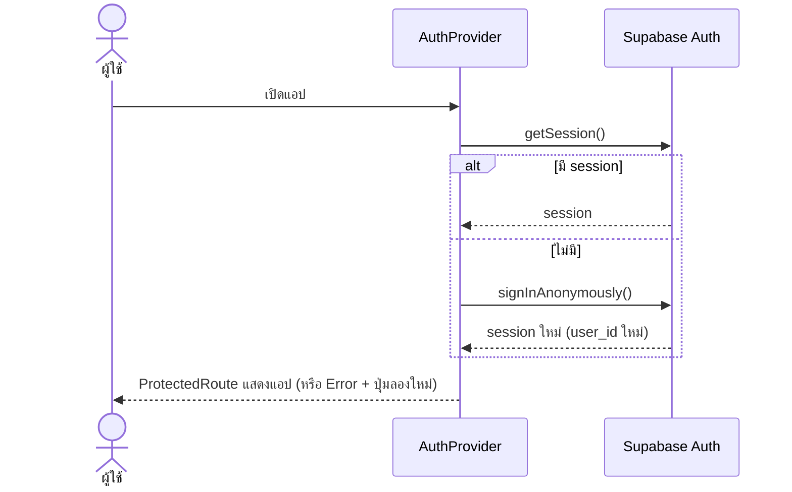

### 8.2 CRUD ทั่วไป (ใช้กับทุกฟีเจอร์)
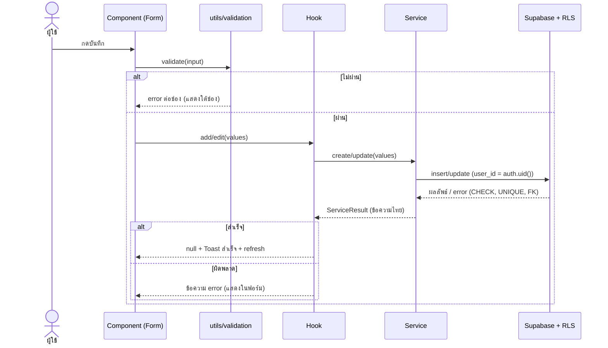

### 8.3 To-do: เปลี่ยนสถานะและ completed_at
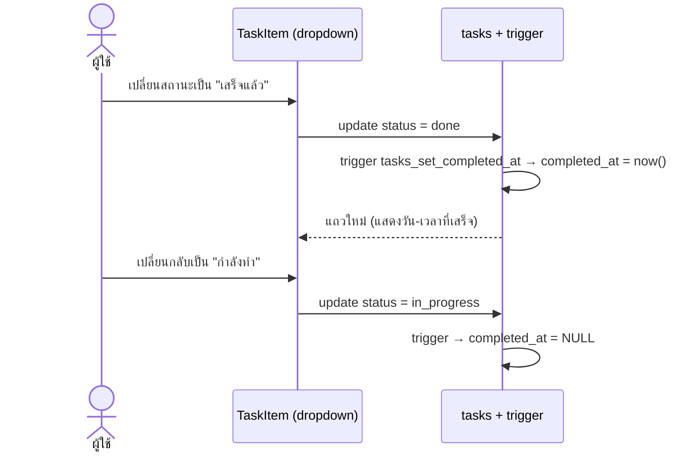
รายการแบ่งหน้าที่ DB: `select … count: exact` + `range(from, to)` (10 ต่อหน้า) กรองสถานะด้วย `in (...)`

### 8.4 Randomizer: session การสุ่ม (client ล้วน)
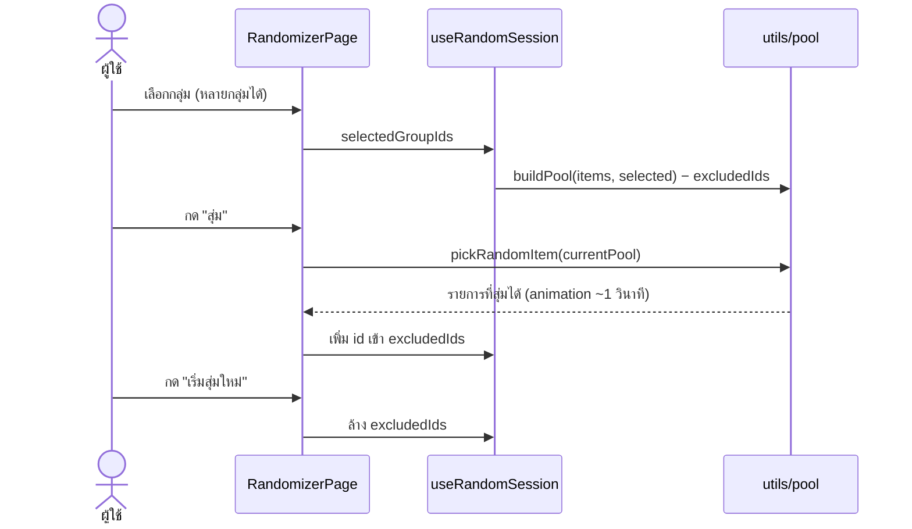
Current/Excluded Pool เป็น state ฝั่ง client (ไม่เก็บ DB) อ้างอิงด้วย `id` ไม่ใช่ข้อความ; ลบรายการที่สุ่มแล้ว → หายจากทั้งสอง pool

### 8.5 Finance: หมวดหมู่เริ่มต้นและบันทึกรายการ
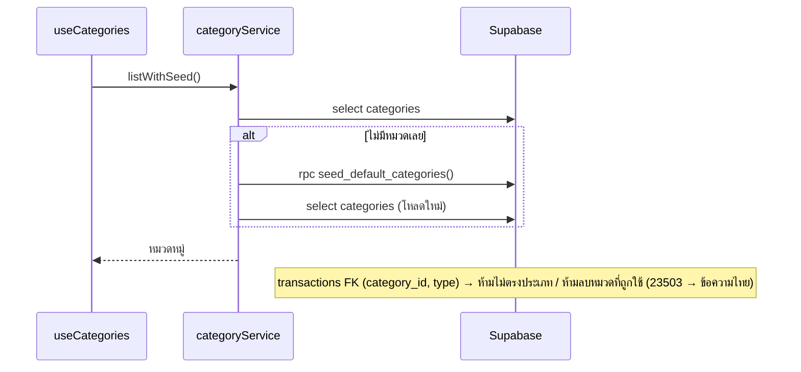
ตัวกรองหน้าสรุป (ช่วงวันที่ เดือน/ปี ประเภท หมวด คำค้น) ส่งเป็นเงื่อนไขของ query; การ์ดสรุปและสรุปตามหมวดคำนวณด้วย `utils/summary.ts`

### 8.6 Calorie: BMR/TDEE และบันทึกอาหาร
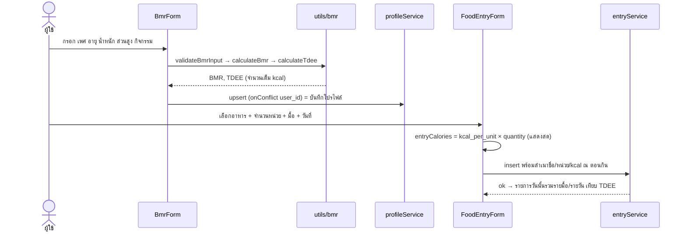
อาหารตั้งต้นถูก seed ด้วย `seed_default_foods()` ตอนเปิดหน้าเมื่อผู้ใช้ยังไม่มีอาหาร; สรุปสัปดาห์/เดือนคำนวณฝั่ง client ด้วย `summarizeRange`

### 8.7 อย่าลืมฉัน: กด "ทำแล้ว" (RPC)
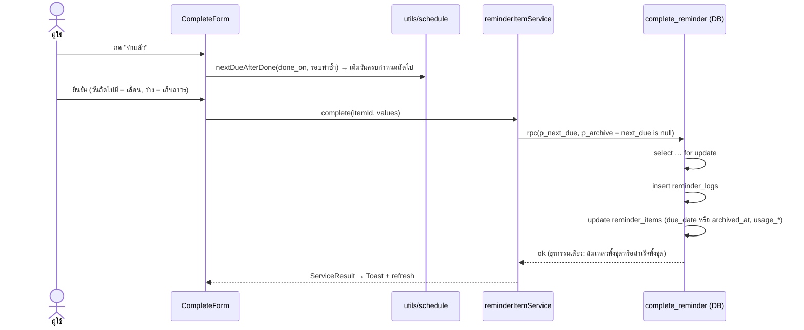
สถานะสี/เตือนคำนวณฝั่ง client จาก `due_date`: `daysLeft`, `getUrgency` (แดง < 7 วัน/เลยกำหนด/ถึงระยะ, เหลือง ≤ 30, เขียว > 30), `reminderStage`/`isReminding`; สรุปค่าใช้จ่ายเดือนหน้าด้วย `summarizeNextMonth` + `countOccurrencesInRange`

### 8.8 ไซส์ไหนคือฉัน: แปลงไซส์
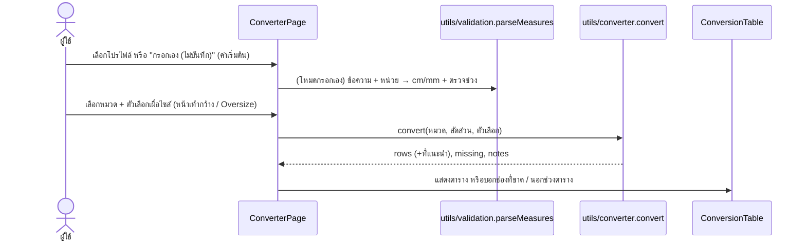
โปรไฟล์/บันทึกไซส์ใช้ Layout ร่วม (`SizeConverterLayout`) โหลดโปรไฟล์ครั้งเดียวแล้วส่งผ่าน Outlet context; ปุ่ม "เพิ่มโปรไฟล์" วางในแถวเมนูย่อยผ่าน React portal

### 8.10 ตัวฉันวันนี้: เช็กอินและการ์ดปลอบใจ
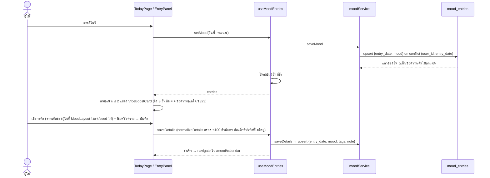
ปฏิทินและสรุปเดือนโหลดทีละเดือน (`monthRange`) แล้วคำนวณสัดส่วน/อารมณ์เด่น/แท็กยอดนิยมที่ฝั่ง client (`utils/stats.ts`); ปุ่มลิงก์ "สุ่มเมนูฮีลใจ" เป็นแค่ลิงก์ไป `/randomizer` ไม่ import โค้ดข้ามฟีเจอร์

### 8.9 เปลี่ยนธีม
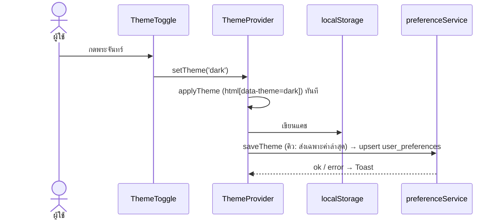

## 9. Logic ที่เป็น pure function
อยู่ใน `utils/` ของแต่ละฟีเจอร์ ไม่ผูกกับ UI และมีเทสต์ใน `tests/` (ดู [test-cases.md](../testing/test-cases.md))

| ฟีเจอร์ | ไฟล์ | ตัวอย่างฟังก์ชัน |
|---|---|---|
| randomizer | `utils/pool.ts` | `buildPool`, `splitPool`, `pickRandomItem` |
| finance | `utils/summary.ts` | `summarize` (ยอดรวมรายรับ/รายจ่าย และสรุปตามหมวด) |
| calorie | `utils/bmr.ts`, `summary.ts`, `dates.ts`, `format.ts` | `calculateBmr`, `calculateTdee`, `validateBmrInput`, `entryCalories`, `summarizeDay`, `summarizeRange` |
| unit-price | `utils/unitPrice.ts`, `units.ts`, `format.ts` | แปลงหน่วยฐาน, ราคาต่อหน่วย, จัดอันดับ, % ที่แพงกว่า, ตรวจกลุ่มหน่วย/ราคาเท่ากัน |
| expiry-tracker | `utils/dates.ts`, `schedule.ts`, `urgency.ts`, `usage.ts`, `reminders.ts`, `costSummary.ts`, `sort.ts`, `validation.ts` | `addMonths` (ปัดสิ้นเดือน), `nextDueAfterDone` (คำนวณจากวันตั้งต้นไม่สะสมคลาด), `getUrgency`, `reminderStage`, `dueDateFromDaysAhead`, `summarizeNextMonth`, `validateItem` |
| size-converter | `utils/shoes.ts`, `rings.ts`, `hats.ts`, `jeans.ts`, `clothing.ts`, `converter.ts` (รวมตัวเลือกเผื่อไซส์), `rounding.ts`, `units.ts`, `validation.ts` + `data/clothingCharts.ts` | ดูสูตรด้านล่าง |
| mood | `utils/calendar.ts`, `stats.ts`, `messages.ts`, `validation.ts`, `tagValidation.ts` | `buildMonthGrid` (เริ่มวันอาทิตย์), `monthRange`, `shiftMonth`, `moodShares` (รวม 100% ด้วย largest remainder), `dominantMood`, `topTags`, `consecutiveDaysWithMood`, `pickMessage`, `normalizeDetails`, `validateEntryDate`, `validateTagName` (ไม่ว่าง ≤ 20 ไม่ซ้ำในกลุ่ม), `canAddTag` (≤ 30) |
| shared | `utils/theme.ts`, `formatCurrency.ts`, `formatDate.ts` | `resolveTheme`, รูปแบบเงิน/วันที่ไทย |

### สูตรของ size-converter
ค่าคงที่อยู่ใน `src/features/size-converter/constants.ts` (ส่วนเผื่อหัวรองเท้า 1.7 cm ใช้ค่าเดียวทุกมาตรฐาน)
| หมวด | สูตร |
|---|---|
| รองเท้า (ผู้ใหญ่, ฐาน = ความยาวเท้า cm) | JP = เท้า (ปัด 0.5) · CN/KR (mm) = เท้า×10 (ปัด 5) · EU = (เท้า + 1.7) × 1.5 ปัดขึ้นครึ่งไซส์ · UK = (เท้านิ้ว × 3) − 23 ปัดครึ่งไซส์ · US ชาย = UK + 1 · US หญิง = UK + 2.5 · UK < 1 (เท้า ≲ 20.3 cm) แสดงเฉพาะ JP/CN/KR |
| แหวน (ฐาน = รอบนิ้ว mm) | ISO/JP = รอบวง − 40 · EU (รอบวง) = รอบวง · US = (เส้นผ่านศูนย์กลาง − 11.63) ÷ 0.8128 ปัด 0.25 · เส้นผ่านศูนย์กลาง = รอบวง ÷ π |
| หมวก (ฐาน = รอบศีรษะ cm) | EU/เอเชีย = รอบศีรษะ · US = รอบศีรษะ ÷ 2.54 ÷ π แสดงเป็นเศษส่วน 1/8 นิ้ว |
| เสื้อ/กางเกง | ตารางช่วง [min, max) (`data/clothingCharts.ts`) เสื้อใช้รอบอก, กางเกงใช้เอวและสะโพก ถ้าชี้คนละไซส์เลือกไซส์ใหญ่กว่า; นอกตารางไม่เดา; ยีนส์ = รอบเอว ÷ 2.54 ปัดจำนวนเต็ม |
| คำแนะนำเผื่อไซส์ | หน้าเท้ากว้าง = คำนวณใหม่ด้วยความยาวเท้า + 0.5 cm; Oversize = ขยับไซส์ตัวอักษรขึ้น 1 |
ค่าที่เศษตกกลางระหว่างสองขั้น (35–65% ของขั้น) แสดงเป็นช่วง เช่น "7.5–8"

## 10. Error handling, Validation, Security
**Error handling**
- Service ทุกตัวห่อ error เป็น `ServiceResult` ไม่ throw; ข้อความทั่วไป "{การกระทำ}ไม่สำเร็จ กรุณาลองใหม่" ไม่เปิดเผยรายละเอียดภายในให้ผู้ใช้ (บันทึกลง console)
- หน้าทุกหน้า: Loading (`Spinner`), Error + ปุ่มลองใหม่ (`ErrorState`), Empty (`EmptyState`), Toast ผลลัพธ์; ฟอร์มแสดง error ต่อช่องและ error ระดับฟอร์ม
- การลบ: `ConfirmDialog` เสมอ

**Validation สองชั้น**
- ชั้น UI: pure function ใน `utils/validation.ts` (หรือเทียบเท่า) คืน error ต่อช่อง
- ชั้น DB: CHECK/UNIQUE/FK ตาม §7 เป็นแนวป้องกันสุดท้าย (ค่าความยาวต้องตรงกับ `constants.ts` ของฟีเจอร์)

**Security**
- RLS ทุกตาราง `auth.uid() = user_id`; composite FK กันข้อมูลข้ามผู้ใช้ (`size_notes`); RPC เป็น security invoker (ทำงานภายใต้ RLS ของผู้เรียก) และเพิกถอนสิทธิ์จาก `public`/`anon`
- ใช้เฉพาะ publishable/anon key ผ่าน env; ห้าม `service_role`; ไม่ hardcode credential
- ไม่มี `eval`/`innerHTML` กับข้อมูลผู้ใช้; React escape ข้อความให้
- ข้อมูลส่วนบุคคลของบุคคลอื่น (โปรไฟล์ไซส์) เก็บใต้ `user_id` ของเจ้าของบัญชีเท่านั้น ไม่แชร์

## 11. Build, Deploy, Migration
- `npm run dev` (Vite) · `npm run build` (`tsc -b && vite build`) · `npm run lint` (oxlint) · `npm test` (`node --test "tests/**/*.test.ts"`)
- Vite แยก vendor chunk (`supabase`, `router`, `react`) และทุกหน้าของฟีเจอร์เป็น lazy chunk
- Deploy: Vercel ตั้ง `VITE_SUPABASE_URL`, `VITE_SUPABASE_PUBLISHABLE_KEY` (ค่า `VITE_*` ฝังตอน build แก้ค่าแล้วต้อง Redeploy); ที่ Supabase ตั้ง Site URL/Redirect URL เป็นโดเมน Vercel
- Migration: รันมือใน Supabase SQL Editor ตามลำดับ §7.5 (ยังไม่มี CI รัน migration)
- Release: tag `vMAJOR.MINOR.PATCH` ให้ตรงกับ `package.json`; PR ติด label `feature`/`improvement`/`bug`/`breaking-change`/`ignore-for-release` ([release.yml](../../.github/release.yml))
- Workflow ก่อนส่งงาน: ตรวจโค้ดด้วย `ocr delegate` → แก้ตามที่ผู้ใช้สั่ง → lint/build/test → commit → อัปเดตเอกสาร spec/testing → เปิด PR (ดู [CLAUDE.md](../../CLAUDE.md) ข้อ 10)

## 12. กลยุทธ์การทดสอบ
| ระดับ | วิธี | เครื่องมือ |
|---|---|---|
| Unit (pure function) | เทสต์อัตโนมัติ 148 เคส | `node:test` (`npm test`) |
| ฐานข้อมูล | ทดสอบ migration/RLS/CHECK/RPC บน PostgreSQL ชั่วคราว (จำลอง `auth.uid()`) และตรวจบน Supabase จริงแบบอ่านอย่างเดียว | psql |
| ทำงานจริง (CRUD, edge case, Responsive, โหมดมืด) | เช็กลิสต์ด้วยมือโดยผู้ใช้ | [docs/testing.md](../testing.md) |
| คุณภาพโค้ด | lint, TypeScript strict, ตรวจโค้ดด้วย OpenCodeReview ก่อน commit | oxlint, `tsc`, `ocr` |
ไม่มี UI/E2E test (ต้องเพิ่มไลบรารี รอผู้ใช้ยืนยัน) รายละเอียด: [test-cases.md](../testing/test-cases.md), [test-results.md](../testing/test-results.md)

## 13. ข้อจำกัดและหนี้ทางเทคนิค
- บัญชี anonymous: ล้างข้อมูลเบราว์เซอร์ = เสียสิทธิ์เข้าถึงข้อมูลเดิม จนกว่าจะมี Login จริง
- ไม่มี UI/E2E test, ไม่มีเทสต์ของ service/hook (ครอบเฉพาะ pure function)
- ข้อมูลอ้างอิงเป็นค่าประมาณ: แคลอรี่อาหาร 102 เมนู, ตารางไซส์เสื้อผ้า (ไซส์ JP ไม่ชัด), ตัวคูณกิจกรรม TDEE
- การเตือนของ "อย่าลืมฉัน" เกิดตอนเปิดแอปเท่านั้น (ไม่มี server-side job)
- ปุ่ม "ฉัน": โปรไฟล์แรกตั้ง `is_self` อัตโนมัติ ยังไม่มีทางย้ายไปโปรไฟล์อื่น (ไม่มีป้ายใน UI)
- แถบเมนูย่อยของฟีเจอร์ finance ยังเลื่อนซ้าย-ขวาเมื่อจอแคบ (ต่างจาก size-converter ที่ตกบรรทัด)
- ตัวฉันวันนี้: สีตามระดับอารมณ์เป็นตัวแปร `--mood-1..5` ใน `index.css` (ขยายข้อยกเว้นสีตามผู้ใช้อนุมัติ); แท็กเป็นข้อมูลของผู้ใช้ (`mood_tags`) แล้ว ขีดจำกัด 30 แท็ก/20 ตัวอักษรอยู่ทั้งใน `constants.ts` และ DB (trigger/CHECK) ต้องแก้ให้ตรงกัน; ลบแท็กแล้วฐานข้อมูลถอดออกจากการเช็กอินเก่าเอง (ย้อนคืนไม่ได้); DB ปฏิเสธวันที่เกินพรุ่งนี้ ส่วนการห้ามเกินวันนี้เป๊ะตรวจที่ฝั่ง client
- ตัวคูณ/ข้อมูลที่ผูกกับ DB และโค้ด (ความยาวสูงสุดของช่อง) ต้องแก้ทั้งสองที่ให้ตรงกัน (`constants.ts` ↔ CHECK)
- ฐานข้อมูลที่ติดตั้งจริงของผู้ใช้อาจรัน migration ไม่ครบ: ตรวจสถานะรายไฟล์ใน [PROGRESS.md](../../PROGRESS.md) หัวข้อ Migrations Applied
